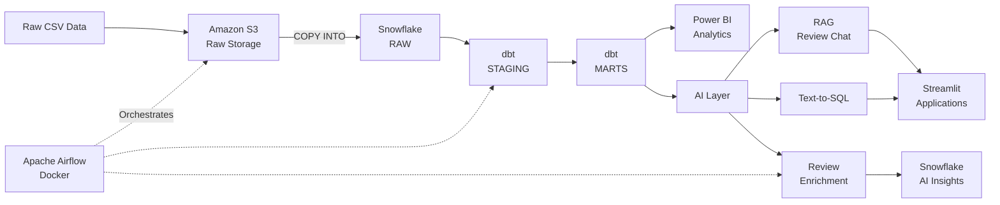
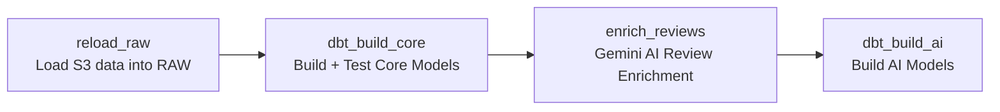

# Zomato AI Data Engineering Platform

An end-to-end data engineering and AI project built using a
food-delivery dataset.

The project takes raw CSV data through **Amazon S3 → Snowflake → dbt →
Airflow**, builds analytics-ready data models, and adds AI capabilities
using **Google Gemini** for review enrichment, RAG-based review search,
and natural-language-to-SQL analytics.

------------------------------------------------------------------------

## Architecture



### Main flow

``` text
Raw CSV files
      ↓
Amazon S3
      ↓
Snowflake RAW
      ↓
dbt STAGING
      ↓
dbt MARTS
      ↓
 ┌────┴───────────────┐
 ↓                    ↓
Power BI           AI Layer
                    ├── Review Enrichment
                    ├── RAG Review Chat
                    └── Text-to-SQL
```

------------------------------------------------------------------------

# 1. Project Overview

This project demonstrates a complete modern data engineering workflow
using one food-delivery dataset.

The pipeline covers:

-   Cloud object storage
-   Data ingestion
-   Data warehousing
-   SQL transformations
-   Data quality testing
-   Dimensional data modeling
-   Workflow orchestration
-   Dockerized Airflow
-   AI-powered data enrichment
-   Retrieval-Augmented Generation (RAG)
-   Natural-language-to-SQL analytics
-   Business intelligence with Power BI
-   Git/GitHub based project management

The AI layer uses **Google Gemini**, not OpenAI.

------------------------------------------------------------------------

# 2. Technology Stack

  Area                 Technology
  -------------------- -------------------
  Object Storage       Amazon S3
  Cloud Access         AWS IAM
  Data Warehouse       Snowflake
  Transformation       dbt
  Orchestration        Apache Airflow
  Containers           Docker
  Programming          Python
  Data Processing      Pandas
  AI / LLM             Google Gemini
  Embeddings           Gemini Embeddings
  Applications         Streamlit
  BI / Visualization   Power BI
  Version Control      Git / GitHub

------------------------------------------------------------------------

# 3. Data Pipeline

The project follows an ELT-style architecture.

### Step 1 --- Raw data

The source dataset contains food-delivery data such as:

-   Users
-   Restaurants
-   Food items
-   Menus
-   Orders
-   Order items
-   Reviews

The raw CSV files are stored in Amazon S3.

### Step 2 --- Load into Snowflake

Snowflake connects to the S3 bucket through an external stage and
storage integration.

The raw files are loaded into the `ZOMATO.RAW` schema using `COPY INTO`.

Example:

``` sql
COPY INTO ZOMATO.RAW.USERS
FROM @ZOMATO.RAW.ZOMATO_RAW_STAGE
FILES = ('user/users.csv')
FILE_FORMAT = (FORMAT_NAME = 'ZOMATO.RAW.CSV_FMT')
ON_ERROR = 'CONTINUE';
```

### Step 3 --- Staging

dbt transforms the raw Snowflake tables into cleaned staging models.

Typical staging work includes:

-   Type conversion
-   Column renaming
-   Null handling
-   Basic standardization
-   Data cleaning
-   Validation

Examples:

``` text
STG_USERS
STG_RESTAURANTS
STG_FOOD
STG_MENU
STG_ORDERS
STG_ORDER_ITEMS
STG_REVIEWS
```

### Step 4 --- Marts

The staging models are transformed into analytics-ready models.

Examples:

``` text
FCT_ORDERS
FCT_ORDER_ITEMS

DIM_CUSTOMER
DIM_DATE
DIM_FOOD
DIM_RESTAURANTS

MART_DAILY_CITY_REVENUE
MART_RESTAURANT_PERFORMANCE
MART_DELIVERY_SLA
MART_REVIEW_INSIGHTS
```

These models are designed for business analysis and Power BI reporting.

------------------------------------------------------------------------

# 4. Snowflake Data Layers

The Snowflake database is organized into logical layers.

## RAW

Contains data loaded from S3 with minimal transformation.

Examples:

``` text
USERS
RESTAURANTS
FOOD
MENU
ORDERS
ORDER_ITEMS
REVIEWS
```

## STAGING

Contains cleaned and standardized dbt models.

Examples:

``` text
STG_USERS
STG_RESTAURANTS
STG_FOOD
STG_MENU
STG_ORDERS
STG_ORDER_ITEMS
STG_REVIEWS
```

## MARTS

Contains business-ready analytical models.

### Fact tables

Facts represent business events or measurable transactions.

``` text
FCT_ORDERS
FCT_ORDER_ITEMS
```

### Dimension tables

Dimensions provide descriptive information about business entities.

``` text
DIM_CUSTOMER
DIM_DATE
DIM_FOOD
DIM_RESTAURANTS
```

### Analytical marts

These models answer specific business questions.

``` text
MART_DAILY_CITY_REVENUE
MART_RESTAURANT_PERFORMANCE
MART_DELIVERY_SLA
MART_REVIEW_INSIGHTS
```

## AI

AI-generated enrichment is stored separately.

``` text
ZOMATO.AI.REVIEW_ENRICHED
```

------------------------------------------------------------------------

# 5. dbt Transformation Layer

dbt is used to manage SQL transformations inside Snowflake.

Instead of manually creating and maintaining every transformation table,
the project uses dbt models to define how the data should be built.

dbt provides:

-   SQL-based transformations
-   Model dependencies
-   Data quality tests
-   Documentation
-   Lineage
-   Materializations
-   Version-controlled transformation code

The general dependency flow is:

``` text
RAW
 ↓
STAGING
 ↓
MARTS
```

For example:

``` text
RAW.USERS
    ↓
STG_USERS
    ↓
DIM_CUSTOMER
```

------------------------------------------------------------------------

# 6. Data Quality

dbt tests are used to validate the data pipeline.

The project includes checks such as:

-   Unique values
-   Required / non-null values
-   Relationships between tables
-   Accepted values
-   Business rules

For example, customer IDs used by the order fact table should correspond
to valid customer IDs in the customer dimension.

This helps detect problems before the data reaches analytics or AI
applications.

------------------------------------------------------------------------

# 7. Airflow Orchestration

Apache Airflow is used to orchestrate the pipeline.

Airflow runs inside Docker.

The main workflow is:



### Pipeline responsibilities

#### `reload_raw`

Loads the raw data from S3 into Snowflake.

#### `dbt_build_core`

Runs dbt transformations and tests for the core data models.

#### `enrich_reviews`

Uses Google Gemini to analyze customer reviews.

#### `dbt_build_ai`

Builds the models that use the enriched review data.

Airflow provides:

-   Scheduling
-   Task dependencies
-   Retries
-   Logging
-   Monitoring
-   Workflow management

------------------------------------------------------------------------

# 8. AI Review Enrichment

Customer reviews contain useful information that is difficult to analyze
using only structured columns.

The project uses **Google Gemini** to convert review text into
structured information.

### Input

``` text
Customer review
```

### Gemini processing

The review is analyzed for:

-   Sentiment
-   Sentiment score
-   Topic
-   Key issue

### Output

The results are stored in:

``` text
ZOMATO.AI.REVIEW_ENRICHED
```

Example structure:

``` text
REVIEW_ID
SENTIMENT_LABEL
SENTIMENT_SCORE
TOPIC
KEY_ISSUE
MODEL
ENRICHED_AT
```

This makes unstructured customer feedback available for SQL analysis and
dashboards.

------------------------------------------------------------------------

# 9. RAG Review Assistant

The project also includes a Retrieval-Augmented Generation application
for asking questions about customer reviews.

The application is built with **Streamlit** and **Google Gemini**.

## RAG flow

``` text
Customer Reviews
      ↓
Generate Embeddings
      ↓
Store Embeddings Locally
      ↓
User asks a question
      ↓
Generate question embedding
      ↓
Cosine similarity search
      ↓
Retrieve top relevant reviews
      ↓
Send retrieved reviews to Gemini
      ↓
Generate answer
```

The application retrieves the most relevant reviews before asking Gemini
to answer.

The LLM is instructed to use only the retrieved customer reviews and
avoid inventing information.

### Why embeddings are used

A keyword search may miss reviews that use different wording.

For example:

``` text
"food arrived late"

"delivery took forever"

"order was delayed"
```

These can have similar meaning even though the words are different.

Embeddings allow the application to compare the semantic similarity
between the question and reviews.

### Embedding cache

The generated review embeddings are stored in a local Parquet file:

``` text
review_embeddings.parquet
```

The cache prevents the application from regenerating embeddings for the
complete review corpus every time the Streamlit application starts.

The cache is excluded from Git.

------------------------------------------------------------------------

# 10. Text-to-SQL AI Application

The project includes another Streamlit application that converts
natural-language business questions into Snowflake SQL.

### Flow

``` text
User Question
      ↓
Google Gemini
      ↓
Generated SQL
      ↓
Safety Validation
      ↓
Snowflake
      ↓
Query Results
      ↓
Table / Chart
```

Example:

``` text
Top 10 cities by GMV
```

Gemini converts the question into SQL based on the available warehouse
schema.

The generated SQL is displayed before execution.

------------------------------------------------------------------------

## Text-to-SQL safety

The application only allows read-oriented SQL.

Allowed:

``` sql
SELECT ...
```

or:

``` sql
WITH ...
SELECT ...
```

The application blocks operations such as:

``` text
DROP
DELETE
TRUNCATE
ALTER
UPDATE
INSERT
CREATE
REPLACE
MERGE
GRANT
REVOKE
```

The Snowflake connection also uses a restricted role rather than running
the application with `ACCOUNTADMIN`.

> Application-side SQL checks are an additional safety layer. A
> read-only Snowflake role is the stronger security boundary.

------------------------------------------------------------------------

# 11. Text-to-SQL Schema

The AI application exposes a controlled set of analytical tables and
columns to Gemini.

Examples include:

``` text
FCT_ORDERS
DIM_RESTAURANT
DIM_CUSTOMER
MART_DAILY_CITY_REVENUE
MART_RESTAURANT_PERFORMANCE
MART_DELIVERY_SLA
```

The AI is instructed to:

-   Use only the provided tables
-   Use only the provided columns
-   Generate Snowflake-compatible SQL
-   Prefer existing analytical marts when they directly answer the
    question
-   Use detailed fact tables when order-level analysis is required
-   Return one SQL query

This reduces the chance of the model inventing database objects.

------------------------------------------------------------------------

# 12. Power BI Analytics

Power BI connects to the analytical models created in Snowflake.

The marts support analysis such as:

### Revenue

-   GMV
-   Revenue
-   Average order value
-   Daily revenue
-   City-level revenue

### Orders

-   Order volume
-   Order status
-   Cancellation rate
-   Payment methods
-   Cuisine performance

### Restaurants

-   Restaurant performance
-   Restaurant revenue
-   Customer ratings
-   Cuisine-level analysis

### Delivery

-   Delivery time
-   Delivery SLA
-   Late delivery rate
-   City-level delivery performance

### Reviews

-   Review sentiment
-   Review topics
-   Common customer issues
-   Review insights

The goal is to keep Power BI focused on analytics-ready data instead of
raw transactional tables.

------------------------------------------------------------------------

# 13. Project Structure

``` text
zomato-ai-data-engineering/
│
├── ai/
│   ├── enrich_reviews.py
│   ├── rag_chat.py
│   └── text_to_sql.py
│
├── airflow/
│   ├── dags/
│   │   └── zomato_batch.py
│   ├── Dockerfile
│   └── docker-compose.yml
│
├── data/
│   └── Raw datasets are kept local and are not committed
│
├── zomato/
│   ├── models/
│   │   ├── staging/
│   │   │   ├── _sources.yml
│   │   │   ├── _staging.yml
│   │   │   ├── _ai_sources.yml
│   │   │   ├── stg_users.sql
│   │   │   ├── stg_restaurants.sql
│   │   │   ├── stg_food.sql
│   │   │   ├── stg_menu.sql
│   │   │   ├── stg_orders.sql
│   │   │   ├── stg_order_items.sql
│   │   │   └── stg_reviews.sql
│   │   │
│   │   └── marts/
│   │       ├── _marts.yml
│   │       ├── dim_customer.sql
│   │       ├── dim_date.sql
│   │       ├── dim_food.sql
│   │       ├── dim_restaurants.sql
│   │       ├── fct_orders.sql
│   │       ├── fct_order_items.sql
│   │       ├── mart_daily_city_revenue.sql
│   │       ├── mart_delivery_sla.sql
│   │       ├── mart_restaurant_performance.sql
│   │       └── mart_review_insights.sql
│   │
│   ├── dbt_project.yml
│   ├── profiles.yml.example
│   ├── analyses/
│   ├── macros/
│   ├── seeds/
│   ├── snapshots/
│   └── tests/
│
├── .gitignore
└── README.md
```

------------------------------------------------------------------------

# 14. Running the Project

## Prerequisites

Install or configure:

-   Python
-   Git
-   Docker Desktop
-   AWS account
-   Snowflake account
-   dbt with Snowflake adapter
-   Google Gemini API access
-   Power BI Desktop

------------------------------------------------------------------------

## Environment variables

Create a local `.env` file.

Example:

``` env
SNOWFLAKE_ACCOUNT=your_account
SNOWFLAKE_USER=your_user
SNOWFLAKE_PASSWORD=your_password
SNOWFLAKE_WAREHOUSE=ZOMATO_WH
SNOWFLAKE_DATABASE=ZOMATO
SNOWFLAKE_SCHEMA=RAW

GEMINI_API_KEY=your_gemini_api_key
GEMINI_MODEL=your_gemini_model
```

Do not commit `.env`.

------------------------------------------------------------------------

# 15. dbt

From the dbt project directory:

``` powershell
cd zomato
dbt build
```

This builds the dbt models and runs configured tests.

For development, individual models can also be run with commands such
as:

``` powershell
dbt run --select stg_users
```

------------------------------------------------------------------------

# 16. Airflow

From the Airflow directory:

``` powershell
cd airflow
docker compose up -d
```

The Airflow containers can then run the batch pipeline.

To stop the containers:

``` powershell
docker compose down
```

------------------------------------------------------------------------

# 17. AI Review Enrichment

From the project root:

``` powershell
python ai/enrich_reviews.py
```

The script:

1.  Reads reviews from Snowflake.
2.  Sends review text to Google Gemini.
3.  Extracts structured review insights.
4.  Stores the results in Snowflake.

------------------------------------------------------------------------

# 18. RAG Application

Install the required Python packages:

``` powershell
pip install numpy pandas streamlit snowflake-connector-python google-genai python-dotenv pyarrow
```

Run the application with Streamlit:

``` powershell
streamlit run ai/rag_chat.py
```

Do not run it with:

``` powershell
python ai/rag_chat.py
```

because it is a Streamlit application.

------------------------------------------------------------------------

# 19. Text-to-SQL Application

Run:

``` powershell
streamlit run ai/text_to_sql.py
```

Example questions:

``` text
Top 10 cities by GMV
```

``` text
Which cuisine has the most orders?
```

``` text
Average delivery time by city, worst first
```

``` text
Cancel rate by payment method
```

The application generates SQL with Gemini, validates the SQL, executes
it in Snowflake, and displays the results.

------------------------------------------------------------------------

# 20. Security

Credentials and private data should never be committed to GitHub.

The repository ignores files such as:

``` text
.env
profiles.yml
data/*.csv
data/creds
review_embeddings.parquet
```

Sensitive values that must remain private include:

-   AWS credentials
-   AWS access keys
-   Snowflake passwords
-   Snowflake connection secrets
-   Gemini API keys
-   Local credential files
-   Raw datasets when they are not intended for public distribution

Use environment variables or secret-management solutions instead.

If a password or API key is accidentally exposed, rotate it immediately.

------------------------------------------------------------------------

# 21. Cost Management

Cloud resources should be stopped when they are not being used.

For Snowflake:

-   Use auto-suspend for warehouses.
-   Avoid leaving warehouses running unnecessarily.
-   Use the smallest suitable warehouse during development.
-   Monitor credit usage.

For Airflow:

``` powershell
docker compose down
```

when development is finished.

For AWS:

-   Monitor S3 storage.
-   Use lifecycle rules when appropriate.
-   Remove unused resources.
-   Configure billing alerts.

For Gemini:

-   Monitor API usage and quotas.
-   Avoid repeatedly embedding the same review corpus.
-   Cache embeddings where appropriate.
-   Use batching where supported.

------------------------------------------------------------------------

# 22. Engineering Concepts Demonstrated

This project demonstrates practical experience with:

``` text
Data Ingestion
        ↓
Cloud Storage
        ↓
Data Warehousing
        ↓
ELT
        ↓
SQL Transformations
        ↓
Data Quality
        ↓
Dimensional Modeling
        ↓
Workflow Orchestration
        ↓
Business Analytics
        ↓
AI Enrichment
        ↓
RAG
        ↓
Natural Language → SQL
```

It also demonstrates software engineering practices such as:

-   Version control
-   Environment-based configuration
-   Modular Python scripts
-   Docker
-   Automated data workflows
-   SQL testing
-   Restricted database access
-   Reusable data models
-   Separation of raw, transformed, and analytical data

------------------------------------------------------------------------

# 23. What This Project Shows

The project brings together several parts of a modern data platform:

### Data Engineering

-   AWS S3
-   Snowflake
-   dbt
-   SQL
-   Python
-   Data modeling
-   Data quality

### Data Platform Engineering

-   Airflow
-   Docker
-   Workflow dependencies
-   Automated pipelines
-   Logging and retries

### Analytics

-   Snowflake marts
-   Power BI
-   Business metrics
-   Revenue analysis
-   Delivery analysis
-   Restaurant analysis
-   Review analysis

### AI Engineering

-   Google Gemini
-   LLM-based enrichment
-   Embeddings
-   Vector similarity search
-   RAG
-   Text-to-SQL
-   Streamlit applications

------------------------------------------------------------------------

# 24. Future Improvements

Possible extensions include:

-   Move the RAG embedding store from local Parquet to a vector
    database.
-   Add incremental processing where appropriate.
-   Add more dbt tests and documentation.
-   Add CI/CD for dbt and Python code.
-   Add automated deployment.
-   Add better SQL validation using an SQL parser.
-   Use a dedicated read-only Snowflake role for the Text-to-SQL
    application.
-   Add monitoring and alerting for pipeline failures.
-   Add more advanced Power BI dashboards.
-   Extend the batch architecture into a streaming architecture using
    Kafka.

------------------------------------------------------------------------

# 25. Screenshots

Project screenshots can be added here.

Suggested screenshots:

``` text
docs/
├── architecture.png
├── aws-s3.png
├── snowflake.png
├── dbt.png
├── airflow.png
├── rag-app.png
├── text-to-sql.png
└── power-bi.png
```

Example:

``` markdown

```

------------------------------------------------------------------------

# 26. Demo

A project walkthrough video can be added here later.

``` markdown
[Watch the project demo](YOUR_VIDEO_LINK)
```

The demo can cover:

1.  Raw data
2.  S3
3.  Snowflake RAW
4.  dbt STAGING
5.  dbt MARTS
6.  Airflow pipeline
7.  Gemini review enrichment
8.  RAG application
9.  Text-to-SQL application
10. Power BI dashboard

------------------------------------------------------------------------

# 27. Key Takeaway

The complete pipeline is:

``` text
                    ZOMATO DATA PLATFORM

Raw CSVs
   │
   ▼
Amazon S3
   │
   ▼
Snowflake RAW
   │
   ▼
dbt STAGING
   │
   ▼
dbt MARTS
   │
   ├──────────────────► Power BI
   │
   ▼
AI Layer
   │
   ├── Gemini Review Enrichment
   │
   ├── RAG Review Assistant
   │
   └── Gemini Text-to-SQL
             │
             ▼
        Snowflake Analytics
```

The project demonstrates an end-to-end workflow from **raw data
ingestion to analytics and AI-powered data applications** using a single
food-delivery dataset.

------------------------------------------------------------------------

## Author

**Aravind S**

Data Engineering \| Python \| SQL \| Snowflake \| dbt \| AWS \| Airflow
\| Google Gemini \| Power BI
